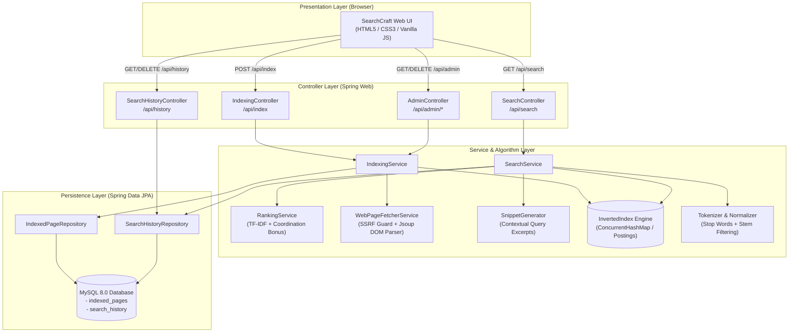

# SearchCraft — Build Your Own Search Engine Using Java

SearchCraft is a mini web search engine built from the ground up using **Java 17, Spring Boot 3, Spring Data JPA, MySQL**, and a custom in-memory **Inverted Index** algorithmic retrieval engine.

Designed for software engineering interviews, campus placements, and systems engineering demonstrations, SearchCraft bridges the gap between raw algorithmic theory (Data Structures & Algorithms) and production-grade full-stack backend engineering.

> [!NOTE]
> SearchCraft is an educational, self-hosted web search engine. It searches across web pages crawled and indexed by this application (or submitted via its Admin interface); it does not crawl the entire internet.

---

## Architecture Overview



---

## Key Features

1. **Clean Search Home & Instant Suggestions**:
   - Modern, responsive search interface.
   - Asynchronous search suggestions populated dynamically from user query history.
   - Interactive popular topic tags (`Java`, `Spring Boot`, `Inverted Index`, `MySQL`, etc.).
2. **Defensive Web Crawler & SSRF Guard**:
   - Accepts public HTTP/HTTPS URLs.
   - Built-in multi-layered **Server-Side Request Forgery (SSRF) Protection** blocking requests to loopback addresses (`127.0.0.1`, `localhost`), private RFC 1918 subnets (`10.0.0.0/8`, `172.16.0.0/12`, `192.168.0.0/16`), and cloud metadata endpoints (`169.254.169.254`).
   - Validates redirects (`301`, `302`, `307`, `308`) against SSRF targets before following.
   - Enforces a 2MB maximum document size cap and strict timeouts to prevent memory exhaustion.
   - Uses **Jsoup** to strip scripts, styles, and noscript tags, extracting clean `<title>`, `<meta name="description">`, `<link rel="canonical">`, and body text.
3. **Core Inverted Index Engine (DSA)**:
   - Built in pure Java using `ConcurrentHashMap<String, Map<Long, Posting>>`.
   - Maps normalized terms to posting entries tracking term frequency across document fields.
   - Supports $O(1)$ candidate retrieval per term.
   - Employs a forward map (`docToTerms`) ensuring $O(K)$ document deletion and pruning dead vocabulary entries to prevent RAM leaks.
   - **Index Rebuild on Boot**: An `ApplicationRunner` automatically restores the inverted index from MySQL upon application restart.
4. **Transparent Relevance Ranking Algorithm**:
   - Field-weighted scoring: Title matches count **5.0x**, Description matches count **2.5x**, and Body matches count **1.0x**.
   - Sublinear term frequency scaling ($1 + \ln(\text{TF})$) to penalize keyword stuffing.
   - Inverse Document Frequency ($\text{IDF}$) to reward rare discriminative terms.
   - Document length normalization penalty to ensure fair ranking between long and short documents.
   - **Query Coordination Coverage**: Multipliers reward documents that match multiple distinct query terms over partial single-word hits.
5. **Contextual Snippets**:
   - Dynamically locates the earliest occurrence of query terms in body text and extracts a ~180-character window clipped at word boundaries with ellipsis (`...`).
6. **Search History Tracking**:
   - Records searches and result counts into MySQL via transactional isolation (`Propagation.REQUIRES_NEW`).
   - One-click history clear endpoint and UI button.
7. **Comprehensive Admin Dashboard**:
   - Real-time statistics: Total Indexed Pages, Inverted Index Terms, Total Searches Executed, and Failed Crawl Attempts.
   - Live URL crawling form with loading spinner.
   - Table of indexed documents with pagination, one-click document deletion, and failed crawl retry triggers.
8. **Robust REST API & Error Handling**:
   - Centralized `@RestControllerAdvice` returning uniform `ErrorResponse` JSON schemas.
   - Prevents stack traces, database credentials, or internal paths from leaking to consumers.

---

## Technology Stack

| Layer | Technology | Rationale |
| :--- | :--- | :--- |
| **Language** | Java 17 LTS / Java 23 | Modern enterprise LTS standard; records, modern switch expressions, strong type safety. |
| **Framework** | Spring Boot 3.3.4 | Auto-configuration, dependency injection, and embedded Tomcat. |
| **Data Access** | Spring Data JPA / Hibernate | Object-Relational Mapping (ORM) and dynamic SQL query generation. |
| **Database** | MySQL 8.0 | Reliable ACID persistence for documents, errors, and search history. |
| **HTML Parser** | Jsoup 1.17.2 | DOM parsing, tag stripping, and canonical metadata extraction. |
| **Testing** | JUnit 5, MockMvc, AssertJ | Automated unit, security, integration, and end-to-end testing (37 tests). |
| **Frontend** | HTML5, CSS3, Vanilla JS | Zero Node/npm build dependencies; clean, lightweight, and responsive. |

---

## Data Structures & Information Retrieval Deep Dive

### 1. Inverted Index vs. Naive SQL LIKE
* **Naive SQL Query**: `SELECT * FROM indexed_pages WHERE extracted_text LIKE '%java%';`
  - Requires an $O(N)$ full table scan, loading megabytes of text from disk into memory.
  - No relevance ranking or field weighting.
* **Inverted Index**:
  - Pre-tokenizes and maps words to document IDs.
  - Lookup time is $O(1)$ on average.
  - Multi-term queries perform set intersections in microseconds.

### 2. Relevance Scoring Formula
$$\text{Score}(d, Q) = \left( \frac{\sum_{t \in Q} (1 + \ln(\text{WeightedTF}(t, d))) \times \text{IDF}(t)}{\text{LengthPenalty}(d)} \right) \times \text{CoordinationBonus}(d, Q)$$

Where:
* $\text{WeightedTF} = (\text{TitleFreq} \times 5.0) + (\text{DescFreq} \times 2.5) + (\text{BodyFreq} \times 1.0)$
* $\text{IDF}(t) = \ln\left(1 + \frac{N - \text{DF}(t) + 0.5}{\text{DF}(t) + 0.5}\right) + 1.0$
* $\text{LengthPenalty}(d) = 0.6 + 0.4 \times \left(\frac{\text{length}(d)}{\text{avgDocLength}}\right)$
* $\text{CoordinationBonus}(d, Q) = 1.0 + \left(\frac{\text{matchedTerms}}{\text{totalQueryTerms}} \times 0.75\right)$

---

## Database Schema

```sql
CREATE DATABASE IF NOT EXISTS searchcraft_db 
CHARACTER SET utf8mb4 
COLLATE utf8mb4_unicode_ci;

-- 1. Indexed Pages Table
CREATE TABLE indexed_pages (
    id BIGINT AUTO_INCREMENT PRIMARY KEY,
    url VARCHAR(2048) NOT NULL,
    canonical_url VARCHAR(768) NOT NULL UNIQUE,
    title VARCHAR(500),
    description VARCHAR(2000),
    extracted_text LONGTEXT,
    http_status_code INT,
    indexing_status VARCHAR(20) NOT NULL,
    last_error VARCHAR(1000),
    indexed_at DATETIME(6) NOT NULL,
    INDEX idx_canonical_url (canonical_url),
    INDEX idx_indexing_status (indexing_status),
    INDEX idx_indexed_at (indexed_at)
);

-- 2. Search History Table
CREATE TABLE search_history (
    id BIGINT AUTO_INCREMENT PRIMARY KEY,
    query_text VARCHAR(255) NOT NULL,
    result_count INT NOT NULL,
    searched_at DATETIME(6) NOT NULL,
    INDEX idx_searched_at (searched_at)
);
```

---

## Project Folder Structure

```text
searchcraft/
├── pom.xml                                   # Maven build specification
├── .gitignore                                # Excludes target/, credentials, IDE cache
├── README.md                                 # Complete documentation
├── mvnw & mvnw.cmd                           # Official Maven Wrapper
├── src/
│   ├── main/
│   │   ├── java/com/searchcraft/
│   │   │   ├── SearchCraftApplication.java   # Main entry point
│   │   │   ├── config/                       # Startup Index Restorer
│   │   │   │   └── IndexInitializationRunner.java
│   │   │   ├── controller/                   # REST Endpoints
│   │   │   │   ├── SearchController.java
│   │   │   │   ├── IndexingController.java
│   │   │   │   ├── AdminController.java
│   │   │   │   ├── SearchHistoryController.java
│   │   │   │   └── StatusController.java
│   │   │   ├── dto/                          # Validated Data Transfer Objects
│   │   │   │   ├── IndexUrlRequest.java
│   │   │   │   ├── SearchRequest.java
│   │   │   │   ├── SearchResponse.java
│   │   │   │   ├── SearchResultDto.java
│   │   │   │   ├── IndexedPageDto.java
│   │   │   │   ├── SearchHistoryDto.java
│   │   │   │   └── DashboardStatsDto.java
│   │   │   ├── entity/                       # JPA Database Entities
│   │   │   │   ├── IndexedPage.java
│   │   │   │   ├── SearchHistory.java
│   │   │   │   └── IndexingStatus.java
│   │   │   ├── exception/                    # Global Exception Handling
│   │   │   │   ├── ErrorResponse.java
│   │   │   │   ├── BadRequestException.java
│   │   │   │   ├── ResourceNotFoundException.java
│   │   │   │   └── GlobalExceptionHandler.java
│   │   │   ├── index/                        # Inverted Index Engine
│   │   │   │   ├── Tokenizer.java
│   │   │   │   ├── Posting.java
│   │   │   │   └── InvertedIndex.java
│   │   │   ├── repository/                   # Spring Data JPA Repositories
│   │   │   │   ├── IndexedPageRepository.java
│   │   │   │   └── SearchHistoryRepository.java
│   │   │   └── service/                      # Core Business Services
│   │   │       ├── IndexingService.java
│   │   │       ├── RankingService.java
│   │   │       ├── SearchService.java
│   │   │       ├── SearchHistoryService.java
│   │   │       ├── SnippetGenerator.java
│   │   │       ├── UrlSecurityValidator.java
│   │   │       └── WebPageFetcherService.java
│   │   └── resources/
│   │       ├── application.properties        # App configuration with ENV defaults
│   │       ├── application.properties.example # Safe template for Git
│   │       └── static/                       # Web UI Assets
│   │           ├── index.html                # Search Home
│   │           ├── results.html              # Search Results
│   │           ├── admin.html                # Admin Dashboard
│   │           ├── css/style.css
│   │           └── js/
│   │               ├── api.js
│   │               ├── search.js
│   │               └── admin.js
│   └── test/java/com/searchcraft/            # Automated Test Suite (37 tests)
│       ├── DatabasePersistenceTest.java
│       ├── EndToEndSearchEngineIntegrationTest.java
│       ├── index/
│       │   ├── TokenizerTest.java
│       │   └── InvertedIndexTest.java
│       ├── service/
│       │   ├── UrlSecurityValidatorTest.java
│       │   ├── WebPageFetcherServiceTest.java
│       │   └── RankingServiceTest.java
│       └── controller/
│           ├── SearchHistoryControllerTest.java
│           ├── IndexingControllerIntegrationTest.java
│           └── SearchControllerIntegrationTest.java
```

---

## Getting Started

### Prerequisites
* **Java**: JDK 17 or higher (`java -version`)
* **MySQL**: MySQL Server 8.0+ running locally (`mysql --version`)
* **Git**: Command-line Git (`git --version`)

### 1. Database Setup
Log into MySQL and create the database:
```sql
CREATE DATABASE IF NOT EXISTS searchcraft_db CHARACTER SET utf8mb4 COLLATE utf8mb4_unicode_ci;
```

### 2. Environment Variables Configuration
Set your environment variables (or configure them in your IDE Run Configuration):
* `DB_URL`: `jdbc:mysql://localhost:3306/searchcraft_db?createDatabaseIfNotExist=true&useSSL=false&serverTimezone=UTC&allowPublicKeyRetrieval=true`
* `DB_USERNAME`: `root` (or your MySQL user)
* `DB_PASSWORD`: `YOUR_MYSQL_PASSWORD`

### 3. Build and Run the Tests
Run all 37 automated tests using the included Maven Wrapper:
```bash
# Windows
.\mvnw.cmd test

# Linux / macOS
./mvnw test
```

### 4. Run the Application
```bash
# Windows
.\mvnw.cmd spring-boot:run

# Linux / macOS
./mvnw spring-boot:run
```

Once started, access the application in your browser:
* **Search Home**: `http://localhost:8080/`
* **Admin Dashboard**: `http://localhost:8080/admin.html`
* **Search Results**: `http://localhost:8080/results.html?q=java`

---

## REST API Reference

| Method | Endpoint | Description |
| :--- | :--- | :--- |
| `GET` | `/api/search?q={query}&page=0&size=10` | Executes keyword search returning ranked documents with snippets. |
| `POST` | `/api/index` | Submits a URL for safe crawling, SSRF validation, and indexing. |
| `GET` | `/api/admin/pages?page=0&size=10` | Retrieves paginated list of all indexed pages. |
| `GET` | `/api/admin/pages/{id}` | Retrieves details for an indexed document. |
| `DELETE` | `/api/admin/pages/{id}` | Deletes a document from MySQL and evicts it from the Inverted Index. |
| `POST` | `/api/admin/pages/{id}/retry` | Retries indexing for a failed URL. |
| `GET` | `/api/admin/stats` | Retrieves system overview metrics (indexed count, terms, searches). |
| `GET` | `/api/history` | Retrieves recent search queries. |
| `DELETE` | `/api/history` | Clears all search history. |
| `GET` | `/api/status` | Application uptime and MySQL connectivity health check. |

---

## Known Limitations & Future Improvements

1. **Crawler Concurrency**: The crawler currently executes single-threaded page fetches upon manual submission. A future enhancement is introducing a bounded thread pool / worker queue for asynchronous background batch crawling.
2. **Robots.txt Parser**: While safe fetching and timeout caps exist, parsing `robots.txt` files directly before queuing links would further improve crawler politeness.
3. **Index Sharding**: In-memory storage is optimized for thousands of documents. For millions of documents, distributed inverted index partitioning (such as Apache Lucene / Elasticsearch shard architectures) would be the natural evolution.

---

## License & Author
* **Project**: SearchCraft — Mini Web Search Engine
* **Intended Use**: Educational, Academic Portfolio & Placement Interviews
* **License**: MIT License
